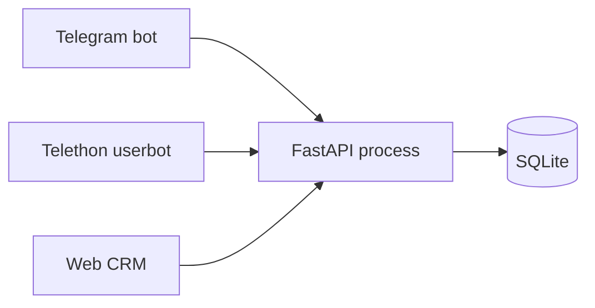

# Мини-CRM для заявок агентства

Лиды из Telegram-бота, из лички и заведённые руками — в одном списке с тегами и фильтром. Тестовое задание; набросок — в `product_sketch.md`, разбор — в `postmortem.md`.

{{скриншот}}

## Возможности

- Telegram-бот: заявка в три шага, long polling в том же процессе
- Юзербот (Telethon): входящие в личку становятся лидами
- Веб-CRM: список, карточка, ручной лид, теги, поиск и пагинация
- Общий CRUD для веба, бота и юзербота
- Smoke-сценарий по HTTP без сети Telegram
- Basic auth для CRM

## Архитектура



## Стек

Python 3.12 · FastAPI · SQLAlchemy 2 async · SQLite · Jinja2 · httpx · Telethon · pytest

## Запуск

```bash
python -m venv .venv
# Windows: .venv\Scripts\activate
source .venv/bin/activate
pip install -r requirements.txt
cp .env.example .env   # BOT_TOKEN и CRM_PASSWORD
mkdir -p data
make run
```

CRM: http://127.0.0.1:8000/leads. После правок кода перезапусти сервер (без `--reload`). Проверяй `/leads`, не только `/healthz`.

Юзербот: `TG_API_ID` / `TG_API_HASH`, затем `python scripts/userbot_login.py`.

Тесты и стиль: `make test`, `make lint`, `make fmt`. Живой стенд — [verification.md](verification.md).

## Конфиг

| Переменная | Назначение |
| --- | --- |
| `BOT_TOKEN` | BotFather; пусто → бот не стартует |
| `TG_API_ID` / `TG_API_HASH` | my.telegram.org для юзербота |
| `CRM_USER` / `CRM_PASSWORD` | HTTP Basic веб-CRM |
| `DATABASE_URL` | Async SQLAlchemy URL |

Полный список — в `.env.example`.

## Автор

Богдан Щербинин ([blessed-bless](https://github.com/blessed-bless))
